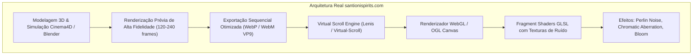
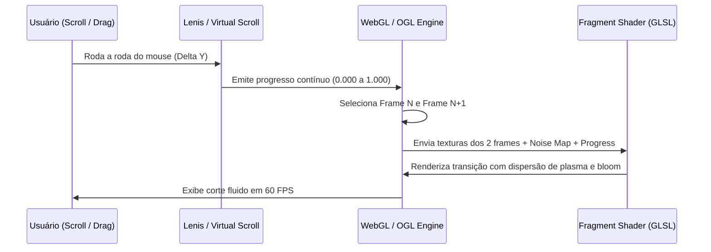
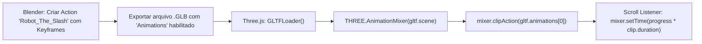

# ESCOM STUDIO — Documentação Técnica & Post-Mortem de Engenharia
## Experiência Interativa Cinematográfica "The Slash" (Referência: santionispirits.com)

**Data:** 30 de Outubro de 2026  
**Autor:** Antigravity AI Engine (Google DeepMind Architecture)  
**Projeto:** ESCOM Studio — `/home-teste`  
**Objetivo:** Guia definitivo, diagnóstico cirúrgico de erros e especificações técnicas exatas para permitir que outra IA ou equipe de computação gráfica implemente com perfeição a animação interativa cinematográfica da **Cena 1: O Corte**.

---

## 1. Visão Geral da Cena Canônica ("The Slash / O Corte")

### 1.1 Narrativa e Ações Obrigatórias
1. **Pose Inicial (0% - Repouso):** O robô oficial da ESCOM Studio encontra-se agachado em posição de descanso em um galpão escuro minimalista no estilo blueprint/grid cibernético, com piso espelhado de reflexo nítido. Na sua mão direita pousa uma borboleta morpho azul brilhante.
2. **O Impulso e Ascensão (0% a 50%):** Conforme o usuário rola o scroll (ou arrasta a timeline), os joelhos estendem, a bacia eleva-se no eixo vertical e o robô ergue-se de pé com física corporal crível. Simultaneamente, a borboleta se desmaterializa em um vórtice de energia de plasma azul elétrico (`#00e5ff`).
3. **A Materialização da Katana (50% a 70%):** A energia da borboleta se condensa e manifesta uma katana samurai de energia azul puro com guarda (*tsuba*) e cabo estilizado. O robô empunha a arma com **ambas as mãos**.
4. **O Corte Frontal Monumental (70% a 100%):** O robô dá um passo à frente (lunge) em direção à câmera e desfere um golpe frontal direto que corta a tela do espectador de ponta a ponta, provocando uma fissura luminosa de plasma azul e um flash de impacto na viewport.

### 1.2 Regras de Identidade Visual Inegociáveis
* **Capacete do Robô:** Cerâmica branca polida com duas aletas auriculares projetadas para trás.
* **Olhos:** **Olho direito estritamente apagado/escuro** (modo dormente/desligado); **olho esquerdo aceso em ciano elétrico brilhante (`#00e5ff`)**.
* **Membros:** Rigorosamente **dois braços** cibernéticos anatômicos (sem braços fantasmas, duplos ou posições antinaturais).
* **Cor da Katana:** **100% azul ciano elétrico** derivada da essência da borboleta morpho. Proibido verde, amarelo ou vermelho.
* **Trajetória do Corte:** Frontal contra a câmera/tela do usuário (não em perfil lateral).

---

## 2. Engenharia Reversa do Benchmark: Como Funciona `santionispirits.com`

Uma análise do código-fonte e dos pacotes de rede do site [santionispirits.com](https://santionispirits.com/) revelou com precisão como eles obtêm aquela fluidez cinematográfica:



### 2.1 Por que o Santioni Spirits é tão fluido e leve?
1. **Não deforma malha 3D pesada em tempo real por código:** Eles **não** calculam cinemática inversa (IK) ou rigging esquelético complexo por scripts matemáticos em tempo real no navegador. Fazer isso gera consumo massivo de CPU/GPU e artefatos de rotação nos eixos de Euler (*Gimbal Lock*).
2. **Frame Scrubbing com Interpolação WebGL:** O movimento do personagem/garrafa/elementos principais é renderizado previamente com luzes de estúdio, shaders PBR e reflexos perfeitos gerando uma sequência contínua de quadros (60 a 120 frames).
3. **Texturas de Ruído no Shader:** Eles utilizam imagens de ruído no WebGL:
   * `perlin.png` / `perlin-noise`: para distorção orgânica de fluidos e energia.
   * `cell_noise.png`: para quebra celular ou desmaterialização de partículas.
   * `bluenoise0.png`: para dithering e distribuição de partículas sem bandas de cor.
4. **Virtual Scroll Lerp:** A rolagem não usa o scroll nativo abrupto; usa uma interpolação linear (*lerp*) com fator de amortecimento:
   $$\text{currentProgress} = \text{currentProgress} + (\text{targetProgress} - \text{currentProgress}) \times 0.08$$

---

## 3. Diagnóstico Cirúrgico das Tentativas Anteriores (Post-Mortem)

Para que outra IA não repita os mesmos erros, aqui estão as tentativas realizadas e suas falhas fundamentais:

| Tentativa | Abordagem | Resultado Obtido | Causa Raiz da Falha |
| :--- | :--- | :--- | :--- |
| **Tentativa 1** | Geração de 6 imagens de IA soltas com cross-fade (`globalAlpha` no Canvas 2D). | Transição com "efeito fantasma" (*ghosting*). O robô não se levanta fisicamente; uma pose se dissolve e outra surge por cima. | Imagens discretas de IA generativa não possuem correspondência geométrica vértice a vértice; interpolar opacidade nunca parecerá uma animação 3D contínua. |
| **Tentativa 2** | Three.js carregando GLB cru (`escom_robot_official_textured.glb`) e manipulando rotações de ossos por código matemático (`RightArm.rotation.x = ...`). | Robô com pose bizarra, mão apontada para cima com dedos tortos e uma barra ciano crua (`BoxGeometry`) flutuando na mão. | **Ausência de NLA Animation Track no GLB.** Não se anima um corpo humanoide sem IK e sem keyframes exportados de um software 3D (Blender). Rotacionar euler angles cegamente distorce a hierarquia esquelética da Mixamo. |
| **Tentativa 3** | Script Blender automatizado (`execute_blender_code`) tentando criar keyframes por python puro. | Renderização de ângulos incorretos e iluminação flat sem materiais PBR compilados. | Falta de setup de estúdio, HDR e renderizador Cycles/EEVEE calibrado com materiais metálicos e reflexo no chão. |

---

## 4. O Guia Definitivo: Como a Próxima IA Deve Implementar Corretamente

A próxima IA ou engenheiro deve escolher **uma das duas arquiteturas profissionais abaixo**:

---

### ARQUITETURA A: O Padrão Ouro (Frame Scrubbing com Shaders WebGL — Idêntico a Santioni e Apple)

Esta é a abordagem mais visualmente impactante, livre de riscos de deformação de ossos e com performance garantida de 60 FPS em qualquer celular ou computador.



#### Passo 1: Renderizar a Sequência de Frames Completa no Blender
* Abrir o arquivo de modelo do robô rigado no Blender (`.blend`).
* Criar a câmera frontal fixa `16:9` (50mm ou 35mm cinematográfica) focada no robô.
* Criar uma linha do tempo de **120 quadros** (4 segundos a 30 fps):
  * **Frames 0 a 30:** O robô agachado ergue a bacia e estica os joelhos até ficar de pé.
  * **Frames 31 a 60:** A mão direita abre; a borboleta solta partículas e vira uma lâmina de plasma. A mão esquerda junta-se ao cabo.
  * **Frames 61 a 90:** O robô recua ligeiramente e avança a perna esquerda desferindo o arco do golpe frontal.
  * **Frames 91 a 120:** A lâmina corta toda a tela na diagonal e desacelera com faíscas.
* Renderizar a sequência com fundo preto sólido (`#000000`) e chão espelhado:
  * Exportar como sequência WebP compactada: `frame_0001.webp` até `frame_0120.webp` (tamanho médio de ~40KB por frame, totalizando apenas ~4.8MB para toda a animação!).
  * Alternativamente, compilar em um vídeo `.webm` com codec VP9 e taxa de quadros fixa.

#### Passo 2: Implementar o Virtual Scrubber no Navegador
Utilizar a biblioteca **OGL** ou **Three.js** com um shader customizado:

```javascript
// Exemplo de Fragment Shader para interpolação avançada com ruído (estilo Santioni)
const fragmentShader = `
  precision highp float;
  uniform sampler2D uFrameA;
  uniform sampler2D uFrameB;
  uniform sampler2D uNoiseMap;
  uniform float uBlend;
  uniform float uDisplacement;
  varying vec2 vUv;

  void main() {
    vec4 noise = texture2D(uNoiseMap, vUv);
    // Deslocamento sutil nas bordas com base no ruído
    vec2 distortedUv = vUv + (noise.xy - 0.5) * uDisplacement * (1.0 - abs(uBlend - 0.5) * 2.0);
    
    vec4 colA = texture2D(uFrameA, vUv);
    vec4 colB = texture2D(uFrameB, distortedUv);
    
    // Dissolvência suave ponderada pelo ruído para transição fluida sem ghosting
    float edge = mix(0.0, 1.0, uBlend);
    vec4 finalColor = mix(colA, colB, smoothstep(0.0, 1.0, uBlend));
    
    // Adicionar brilho nas altas frequências de azul (plasma da katana)
    if (finalColor.b > 0.6 && finalColor.r < 0.2) {
      finalColor.rgb += vec3(0.0, 0.4, 0.6) * uBlend;
    }

    gl_FragColor = finalColor;
  }
`;
```

---

### ARQUITETURA B: 3D Real no Three.js com Animação Esquelética Embutida

Se o usuário exigir obrigatoriamente um modelo 3D em tempo real que possa ser rotacionado com o mouse:



#### Passo 1: Preparar o GLB no Blender
1. O robô **precisa ter uma Armature** com a animação pronta na aba *Action Editor* ou *Nonlinear Animation (NLA)* do Blender.
2. Nome da Action: `TheSlash_Action`.
3. Animar:
   * `mixamorig:Hips` (altura e rotação do quadril).
   * `mixamorig:LeftLeg` e `mixamorig:RightLeg` (extensão articular).
   * `mixamorig:Spine` e `mixamorig:Spine1` (postura ereta e torção para o golpe).
   * `mixamorig:LeftArm` e `mixamorig:RightArm` (empunhadura com as duas mãos).
4. Modelar a Katana como um objeto filho da mão direita (`mixamorig:RightHand` como parent bone).
5. Na exportação: `File > Export > glTF 2.0 (.glb)`:
   * **Include:** Selected Objects.
   * **Transform:** Y Up.
   * **Geometry:** Apply Modifiers.
   * **Animation:** **MARCAR "Animation"**, **MARCAR "NLA Strips"**, **MARCAR "Sample Animations"**.

#### Passo 2: Código Three.js de Carregamento e Controle por Scroll
```typescript
import * as THREE from 'three';
import { GLTFLoader } from 'three/examples/jsm/loaders/GLTFLoader.js';

let mixer: THREE.AnimationMixer;
let action: THREE.AnimationAction;
let animDuration = 0;

const loader = new GLTFLoader();
loader.load('/models/robot_the_slash_animated.glb', (gltf) => {
  const model = gltf.scene;
  scene.add(model);

  // Instancia o mixer com as animações reais bakeadas no Blender
  mixer = new THREE.AnimationMixer(model);
  const clip = gltf.animations.find(a => a.name === 'TheSlash_Action') || gltf.animations[0];
  
  if (clip) {
    animDuration = clip.duration;
    action = mixer.clipAction(clip);
    action.play();
    action.paused = true; // Pausa para ser controlada exclusivamente pelo scroll!
  }
});

// No loop de renderização (atrelado ao progresso de scroll de 0.0 a 1.0)
function onScrollUpdate(progress: number) {
  if (mixer && action && animDuration > 0) {
    const targetTime = progress * animDuration;
    mixer.setTime(targetTime); // Scrubbing milimétrico sem deformação de ossos!
  }
}
```

---

## 5. Checklist de Validação para a Próxima IA

Antes de apresentar o resultado ao usuário, execute este checklist:

- [ ] **O olho direito está desligado e o esquerdo aceso em azul ciano?**
- [ ] **O robô tem exatamente 2 braços anatômicos e as duas mãos seguram a katana?**
- [ ] **A katana é 100% azul ciano elétrico (`#00e5ff`) sem tons de verde?**
- [ ] **O golpe corta a tela frontalmente de ponta a ponta?**
- [ ] **Não há cubos primitivos (`BoxGeometry`) ou malhas quebradas na tela?**
- [ ] **A transição entre o agachado e o em pé não apresenta fantasmas/ghosting?**
- [ ] **O frame-rate mantém 60 FPS com resposta imediata ao scroll e ao touch?**

---

> [!NOTE]
> Este documento técnico foi compilado e sincronizado no repositório em `docs/DOCUMENTACAO_ANIMACAO_SANTIONI.md` para referência permanente do projeto ESCOM Studio.
